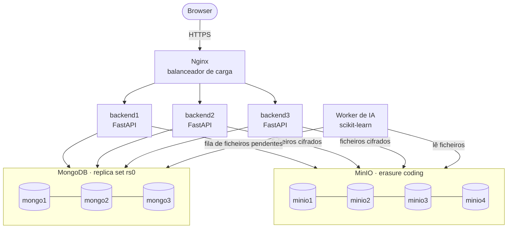

<div align="center">

# ❀ Blue Garden

**Repositório de ficheiros distribuído on-line, com organização automática por Inteligência Artificial**


Projeto de Desenvolvimento de Software · L-EI · IADE – Universidade Europeia · 2026/2027

</div>

---

## Índice

- [Sobre o projeto](#sobre-o-projeto)
- [Funcionalidades](#funcionalidades)
- [Arquitetura](#arquitetura)
- [Como correr](#como-correr)
- [Demonstração de tolerância a faltas](#demonstração-de-tolerância-a-faltas)
- [Inteligência Artificial](#inteligência-artificial)
- [Estrutura do código](#estrutura-do-código)
- [Equipa](#equipa)

---

## Sobre o projeto

O **Blue Garden** é um repositório de ficheiros on-line, semelhante ao Google Drive, que guarda os ficheiros de forma **distribuída e tolerante a faltas** e os **organiza automaticamente por categoria** com IA.

O utilizador carrega os ficheiros e encontra-os já arrumados. Quando a IA não tem certeza suficiente, o ficheiro vai para **Por rever**, e cada correção do utilizador serve para treinar o modelo outra vez.

## Funcionalidades

| | |
|---|---|
| **Contas** | Registo e login com passwords bcrypt e sessões JWT |
| **Ficheiros** | Upload, download, pastas, pesquisa por nome |
| **Cifragem** | Ficheiros cifrados com Fernet no backend antes de chegarem ao armazenamento |
| **Categorização automática** | Académico · Fotografias · Capturas de ecrã · Código · Faturas e finanças · Documentos pessoais · Por rever |
| **Correções** | O utilizador corrige a categoria e a correção fica guardada para retreino |
| **Reciclagem** | Apagar, restaurar ou eliminar definitivamente |
| **Tolerância a faltas** | O sistema continua a funcionar com backends, nós da BD ou nós de armazenamento em baixo |

## Arquitetura



| Componente | Réplicas | Falhas suportadas | Como se deteta e recupera |
|---|:---:|---|---|
| Backend (FastAPI) | 3 | até 2 | O Nginx marca a instância como falhada e repete o pedido noutra |
| MongoDB | 3 | 1 | Heartbeats do replica set e eleição automática de novo primário |
| MinIO | 4 | 1 na escrita, 2 na leitura | Erasure coding; o backend tenta o nó seguinte |
| Worker de IA | 1 | — | Os uploads continuam; os ficheiros ficam em fila até o worker voltar |
| Nginx | 1 | — | Único ponto de falha assumido (trabalho futuro: 2 Nginx + keepalived) |

O modelo de faltas considera apenas **falhas por paragem** (*crash faults*); falhas bizantinas estão fora do âmbito.

## Como correr

### Requisitos

- [Docker Desktop](https://docs.docker.com/desktop/) (Windows/macOS) ou Docker Engine + Compose (Linux)
- [Git](https://git-scm.com/)
- 8 GB de RAM recomendados (o sistema arranca 12 contentores)
- No Windows, correr os scripts `.sh` no **Git Bash**

### Arranque

```bash
git clone https://github.com/mimofixe/BlueGarden.git
cd BlueGarden
git switch codigo

./scripts/gerar_env.sh          # cria o .env com segredos e o certificado HTTPS
docker compose up -d --build    # a primeira vez demora alguns minutos
docker compose ps               # todos os serviços devem estar "running"
```

Depois, abrir **https://localhost**, aceitar o aviso do certificado autoassinado e criar uma conta.

| Endereço | Para quê |
|---|---|
| https://localhost | Aplicação |
| https://localhost/api/docs | Documentação interativa da API |
| https://localhost/api/saude/detalhe | Estado do MongoDB e do MinIO vistos por um backend |
| http://localhost:9001 | Consola do MinIO (credenciais no `.env`) |

### Comandos úteis

```bash
docker compose logs -f backend1                       # ver logs em tempo real
docker compose up -d --build backend1 backend2 backend3   # aplicar alterações ao backend
docker compose stop                                   # parar tudo (os dados ficam)
docker compose down -v                                # apagar tudo, incluindo os dados
```

> [!NOTE]
> A MinIO deixou de publicar imagens Docker oficiais em 2026. Usamos `cgr.dev/chainguard/minio`, que é a mesma MinIO compilada a partir do código-fonte oficial.

## Demonstração de tolerância a faltas

```bash
./demo/demo_falhas.sh            # todos os cenários
./demo/demo_falhas.sh mongo      # só um: backend | mongo | minio | minio2 | ia
```

| Cenário | O que acontece | Resultado esperado |
|---|---|---|
| `backend` | Para o `backend2` | Os pedidos passam para os outros 2 backends |
| `mongo` | Para o primário do MongoDB | Novo primário eleito em ~10 s; uploads continuam |
| `minio` | Para 1 nó MinIO | Leitura e escrita continuam |
| `minio2` | Para 2 nós MinIO | Leitura continua; escrita é recusada sem perda de dados |
| `ia` | Para o worker de IA | Uploads continuam; ficheiros são categorizados quando o worker volta |

## Inteligência Artificial

Cada ficheiro passa por três etapas:

1. **Extração**: texto de PDF, DOCX, TXT e código; EXIF, dimensões e OCR (Tesseract) nas imagens.
2. **Regras**: tratam os casos óbvios (extensão de código, EXIF de câmara, nome de captura de ecrã, indicadores de fatura).
3. **Modelo**: **TF-IDF + Regressão Logística** (comparável com Naive Bayes) sobre o nome, a extensão e o conteúdo.

Se a confiança for **inferior a 0,6**, o ficheiro vai para **Por rever**.

As correções dos utilizadores ficam guardadas na coleção `correcoes`. Para retreinar:

```bash
docker compose exec ai-worker python train.py --correcoes --avaliar
```

O worker passa a usar o modelo novo sem ser reiniciado. Para usar Naive Bayes: `--algoritmo nb`.

## Estrutura do código

```
.
├── backend/           API FastAPI (autenticação, ficheiros, pastas, reciclagem)
├── ai/                Worker de IA (extração, regras, modelo, treino, dataset)
├── frontend/          Interface web (HTML, CSS e JavaScript, sem frameworks)
├── nginx/             Configuração do balanceador de carga e HTTPS
├── mongo/             Script de arranque do replica set
├── demo/              Script de demonstração das falhas
├── scripts/           Utilitários (gerar .env e certificados)
└── docker-compose.yml Definição de todos os serviços
```

## Segurança

- O `.env` (segredos) e `nginx/certs/` **nunca** vão para o Git (ver `.gitignore`).
- A `FERNET_CHAVE` do `.env` decifra todos os ficheiros: **se se perder, os ficheiros ficam ilegíveis**. Partilhar só por mensagem privada dentro do grupo.

## Equipa

**Grupo 3**

| Nome |
|---|
| Francisco Lourinho |
| David Bação |
| Lucas Nicolau |

Docente: Rui Pascoal
